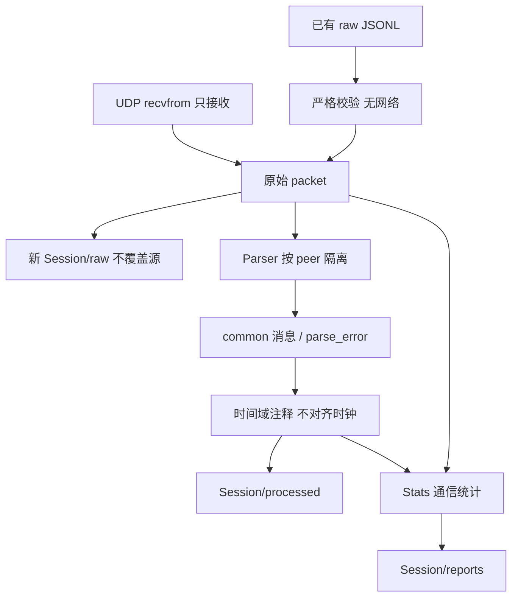

# 架构：被动采集与可复现重放

## 目标和非目标

V0.1 面向 PX4 已存在的 UDP MAVLink 遥测流，保存原始数据、解析 common 消息并报告通信观测。**不向飞控发送数据，不自动发现/查询设备，不执行控制，不读取 ULog，不输出故障根因结论。** 当前能力不是飞行安全系统，也没有实机验证声明。



## 模块与实际接口

| 层 | 接口与职责 | 不承担的职责 |
| --- | --- | --- |
| 采集 | [collectors/udp.py](src/px4_flight_diag/collectors/udp.py) `receive_packets(bind_host, bind_port, duration, ready=None)`；IPv4 UDP 排他监听、接收时间戳与 Base64 原始包 | 不发送、转发、请求遥测，不验证飞控身份 |
| 解析 | [communication/parser.py](src/px4_flight_diag/communication/parser.py) `Parser.feed(packet)` 返回记录列表；`pending_bytes()` 返回残留字节；按 `(IP,port)` 隔离跨包状态 | 不开 socket；不验证签名，不支持自定义 dialect |
| 时间 | [timebase/normalize.py](src/px4_flight_diag/timebase/normalize.py) `normalize_time(msg_type,fields)` 保留源字段并注释单位/时间域 | 不估计时钟偏移，不把 boot 时间强行转为 UTC |
| 存储 | [storage/session.py](src/px4_flight_diag/storage/session.py) `Session`、`read_packets`、严格 JSON 序列化 | 不覆盖原始输入、不静默修复坏行 |
| 分析 | [analysis/stats.py](src/px4_flight_diag/analysis/stats.py) `Stats.add_packet/add_record/summary`；在线计数、接收间隔和序号观测 | 不判飞行故障根因，不用缺口计算确证丢包率 |
| 编排 | [cli.py](src/px4_flight_diag/cli.py) `capture` / `replay` 共用 `process` | 不启动 SDK、Web 控制台或设备控制任务 |

解析器正在独立演进，具体错误类型与重同步策略应以对应版本实现及测试为准；本架构不把参考仓库算法当成本工程已完成的实现。未知 ID 记录为 `unknown_message` 错误，不计有效消息，因为无法验证其 CRC_EXTRA。有效帧的 CRC 只校验帧完整性，来源/IP/SYSID 也不证明身份。当前来源状态数没有全局配额，损坏长度的不完整候选可能保留 pending 等待后续字节，没有超时清理；不能宣称对恶意输入具备完整资源防护。

## 数据生命周期

每次 capture/replay 都新建 `<output_root>/<drone>/<UTC时间>-<随机后缀>/`，包含：

```text
metadata.json
raw/udp.jsonl
processed/messages.jsonl
plots/
reports/summary.json
```

`plots/` 当前仅预留，不意味着已经生成图表。输出采用排他创建；原始包在解析前写入并 flush。干净关闭时 raw/processed 文件执行 fsync，但不保证掉电时最后一条记录完整。summary 记录 `completed/interrupted/failed`；失败会尽量保留已接收证据和错误，文件系统失败等仍可能使 summary 不完整。

重放读取原文件，检查 schema、packet index、接收单调时间、来源结构、UTC 时区、Base64 和长度，再把同一包记录写到新会话 raw 中；保留原接收时间，而非重放执行时间。JSON 排版可能重新序列化，因此这是包记录/载荷的复制，不承诺文件字节级副本。metadata 记录原始输入绝对路径和工具版本。

### 为什么先用 JSONL 而不是数据库

V0.1 优先需要逐包追加、保留坏数据、可检查的交换格式和离线重放。JSONL 允许流式写入/读取，一行定位错误，无需数据库服务或迁移系统，原始 Base64 可完整保留 datagram。代价是空间开销、没有索引/事务查询、同步 flush 吞吐限制以及崩溃时末行可能截断；它并不自动提供不可篡改保证。

若后续需要跨会话索引或长时查询，可从原始日志构建可重建数据库索引，而不是让数据库成为唯一原始证据。索引和清洗产物不得反向修改 raw；容量与性能要用实际负载测量。

### 未来整合位置（尚未实现）

- **pyulog**：新增离线 ULog importer，将 uORB 原值、实例、固件版本和源时间保留到独立记录模型，再进入显式时间域/重启分段与对照分析。不把 ULog 填成伪 UDP 包，也不假设 MAVLink 与 uORB 严格等价。
- **FastAPI**：作为只读会话/摘要查询服务包在存储与分析输出之上，不在采集器内嵌控制路由；优先绑定 localhost，授权/路径访问/敏感日志另做审查。不得通过 HTTP API 绕回飞控发送。
- **Plotly**：消费 processed/analysis 派生结果，输出 plots 下的离线图或由只读服务展示；图上标注单位、坐标、时间域、缺测和来源。绘图不更改 raw，也不能把相似曲线变成根因证明。

这些组件未加入当前运行管线；引入前分别定义数据兼容、资源边界与独立验证。

## 配置和操作边界

capture YAML 恰好包含 `bind_host`、`bind_port`、`duration_seconds`、`drone`、`output_root`。端口为整数 1–65535，时长须正且有限，drone 由存储层限制为字母/数字/下划线/连字符。未提供源 IP 白名单、身份认证或主动流速协商；监听地址应由操作人员明确选择。`drone` 是会话标签，不是已验证 SYSID。

端口被其他地面站占用时应失败，不设置共享接收来抢包。没有收到消息可能只是上游未向该地址发送，不应自动增加心跳或请求来“修复”。已有地面站和飞控的数据流配置必须由用户在本工具之外负责。

## 时间和统计语义

- 接收 `recv_monotonic_ns` 用于同一采集会话的间隔；`recv_utc` 供人类关联。两者不等于传感器采样时刻。
- `time_boot_ms/time_boot_us` 属于 boot 域；SYSTEM_TIME 的 `time_unix_usec` 属于 unix；通用 `time_usec` 为 unknown，不按数值大小猜域。`clock_alignment` 固定为 null。
- 按来源、SYSID、COMPID、消息类型统计频率/间隔；序号按来源、SYSID、COMPID（跨类型）观察，因为 MAVLink seq 不是每消息类型独立计数。
- 多帧在一个 UDP 包中完成时可具有相同接收时间；分片帧归于完成解析的包。这是接收观测，不等于消息生产周期。
- 序号重复/乱序/回绕/重启、过滤与传输丢失可能混淆。summary 的结论必须保持“无法判断故障根因”。

更多字段见 [数据契约](docs/DATA_CONTRACT.md)，验证设计见 [实验规范](docs/EXPERIMENTS.md)。未来自定义 dialect、ULog、时钟对齐、可视化和诊断规则必须另立范围及测试，不能通过文档描述冒充已实现功能。
